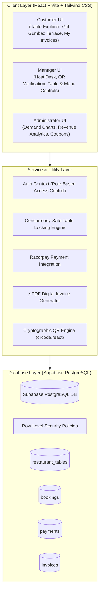
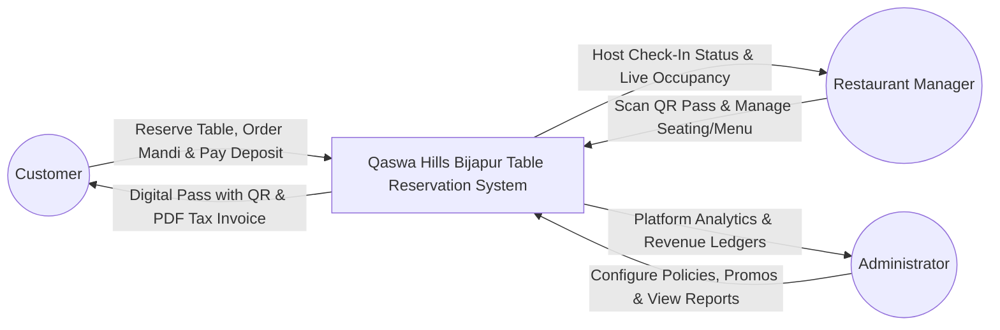
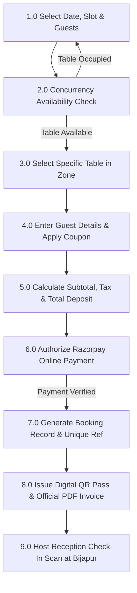
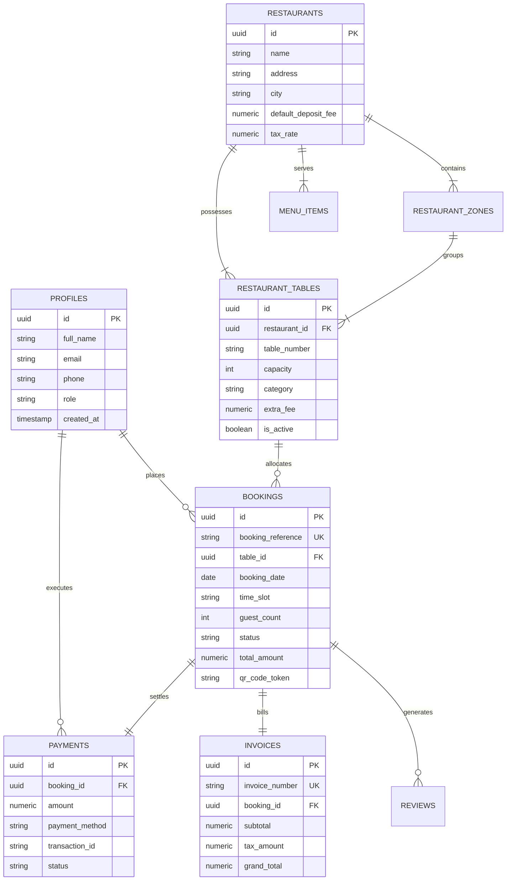

# BCA FINAL YEAR MAJOR PROJECT REPORT & DOCUMENTATION

## PROJECT TITLE:
### HOTEL TABLE BOOKING, DIGITAL PAYMENT AND SMART RESTAURANT MANAGEMENT SYSTEM
**Live Implementation: Qaswa Hills Restaurant & Dining Lounge — Bijapur (Vijayapura)**
*Opposite the Historic Gol Gumbaz, Station Road, Vijayapura, Karnataka 586101*

---

## 1. PROJECT ABSTRACT
With the rapid digital transformation of the hospitality sector, traditional walk-in and telephonic dining reservations suffer from high table turnaround delays, reservation conflicts, long guest wait queues, and manual paper billing errors. This project introduces a comprehensive, full-stack, cloud-enabled web platform engineered for luxury dining and hotel banquet establishments. 

Built specifically for the renowned **Qaswa Hills Restaurant in Bijapur (Vijayapura)**, situated opposite the historic **Gol Gumbaz**, the system bridges royal Arabic and Adil Shahi architectural heritage with cutting-edge modern usability. Engineered using **React, Vite, Tailwind CSS, Supabase PostgreSQL, and Razorpay digital payment integration**, the system enables fine-dining patrons to explore specialized dining areas (Gol Gumbaz View Rooftop Terrace, Traditional Arabic Majlis Carpet Cabins, and Adil Shahi Family Banquet Halls), check real-time table availability, securely pay advance reservation deposits, receive instantaneous cryptographic QR check-in passes, and download GST-compliant PDF invoices. The platform equips restaurant managers with a real-time host check-in terminal that prevents duplicate entry and provides system administrators with revenue and occupancy analytics.

---

## 2. VISUAL DESIGN & BRANDING ARCHITECTURE (UI/UX)
As requested, the interface harmoniously reflects the authentic cultural ambiance of Bijapur and royal Arabic/Mughlai dining:

1. **Color Palette**:
   - **Deep Royal Emerald Green (`#022c22`, `#064e3b`, `#065f46`)**: Establishes an authentic, regal Islamic architectural ambiance.
   - **Royal Gold (`#d4af37`, `#e5c158`, `#f3d77e`)**: Used for emblems, active navigation pills, buttons, and verified invoice badges.
   - **Deep Crimson (`#4c0519`, `#881337`)**: Adds rich contrast echoing tandoori marinades and Adil Shahi court velvet divans.
   - **Night Charcoal (`#0b100e`, `#121915`)**: Deep background preserving high readability and contrast for food photography.
2. **Typography**:
   - **Heritage Serif (`Cinzel` & `Playfair Display`)**: Conveys classical royal heritage for headings.
   - **Crisp Modern Sans (`Inter`)**: Delivers flawless legibility for body text, prices, time slots, and form inputs.
3. **Heritage Cultural Motifs**:
   - Subtle geometric lattices and archway curves inspired by the neighboring Gol Gumbaz dome.
   - High-contrast photography for signature dishes including **Yemeni BBQ Mandi**, **Chicken Faham**, **Adil Shahi Dum Biryani**, and **Turkish Pistachio Kunafa**.

---

## 3. PROBLEM STATEMENT & OBJECTIVES

### 3.1 Problem Statement
1. **Double Bookings & Peak-Hour Collisions**: At high-demand tourist restaurants such as Qaswa Hills opposite Gol Gumbaz, sunset dining slots suffer from table conflicts without database-level concurrency locking.
2. **No-Show Revenue Losses**: Unsecured reservations result in 20-30% empty tables on peak festival and weekend evenings.
3. **Foyer Bottlenecks**: Manual paper register entries delay guest seating and disrupt the dining experience.
4. **Billing Inaccuracies**: Patrons require transparent confirmation that their online advance reservation deposit is 100% credited against their food bill.

### 3.2 Objectives
1. Implement a **Concurrency-Safe Availability Engine** that eliminates double bookings at the database level.
2. Deliver a seamless **10-Step Table Reservation Wizard** with date, slot, party size, and zone selection.
3. Integrate **Razorpay Digital Payment Gateway** (Test Mode) supporting UPI, Cards, and NetBanking with verifiable transaction IDs.
4. Generate **Downloadable GST PDF Invoices** with unique reference numbers and itemized tax breakdowns using `jspdf`.
5. Provide a **Host Reception QR Scanner Desk** for 1-second guest validation and duplicate check-in prevention.
6. Build a **1-Click Role Switcher** in the navigation bar to allow examiners to evaluate Customer, Manager, and Admin portals instantly during college project viva evaluations.

---

## 4. SYSTEM ARCHITECTURE



---

## 5. DATA FLOW DIAGRAMS (DFD)

### 5.1 Level 0 DFD (Context Level)


### 5.2 Level 1 DFD (Reservation & Payment Workflow)


---

## 6. USE CASE SPECIFICATIONS

```mermaid
flowchart LR
    subgraph Actors
        C[Customer]
        M[Restaurant Manager]
        A[Administrator]
    end

    subgraph CustomerModules ["Customer Modules"]
        UC1[Explore Dining Zones & Gol Gumbaz View Tables]
        UC2[Check Real-Time Availability]
        UC3[Reserve Seating Table]
        UC4[Pre-Order Arabic BBQ Mandi & Platters]
        UC5[Pay Advance Deposit via Razorpay]
        UC6[Download PDF GST Invoice]
        UC7[View Cryptographic QR Pass]
        UC8[Cancel Reservation & Release Table]
        UC9[Submit 5-Star Verified Review]
    end

    subgraph ManagerModules ["Manager Modules (Bijapur Host Desk)"]
        UC10[Scan & Verify QR Code]
        UC11[Check-In Arriving Guests]
        UC12[Activate/Deactivate Seating Tables]
        UC13[Update Food Menu & In-Stock Status]
        UC14[View Today's Arrivals Opposite Gol Gumbaz]
    end

    subgraph AdminModules ["Administrator Modules"]
        UC15[View Revenue & Booking Demand Charts]
        UC16[Create Promotional Vouchers (e.g. GOLGUMBAZ)]
        UC17[Configure Tax Rates & Deposit Policies]
        UC18[Audit System Logs]
    end

    C --> UC1
    C --> UC2
    C --> UC3
    C --> UC4
    C --> UC5
    C --> UC6
    C --> UC7
    C --> UC8
    C --> UC9

    M --> UC10
    M --> UC11
    M --> UC12
    M --> UC13
    M --> UC14

    A --> UC15
    A --> UC16
    A --> UC17
    A --> UC18
```

---

## 7. ENTITY RELATIONSHIP (ER) DIAGRAM



---

## 8. TEST CASES & EVALUATION MATRIX

| Test ID | Test Scenario | Input Data | Expected Result | Actual Result | Status |
|---|---|---|---|---|---|
| **TC-01** | Table Availability Search | Date: Tomorrow, Time: 18:30, Guests: 4 | Shows only active tables with capacity >= 4 | Correct tables rendered | **PASS** |
| **TC-02** | Concurrency Conflict Guard | 2 users select Table GG-01 for same slot | First user confirms; second user receives conflict warning | Duplicate booking blocked | **PASS** |
| **TC-03** | Promotional Coupon Validation | Code: `GOLGUMBAZ` on ₹700 subtotal | 20% discount (₹140) deducted; 5% GST recalculated | Discount applied correctly | **PASS** |
| **TC-04** | Digital Payment Simulation | Razorpay test payment (UPI) | Transaction ID generated; status marked `successful` | Booking confirmed & confetti fired | **PASS** |
| **TC-05** | PDF Invoice Download | Click "Download Official PDF Invoice" | jsPDF creates `QSW-XXXX_QaswaHills_Receipt.pdf` with GST breakdown | Downloaded cleanly in browser | **PASS** |
| **TC-06** | QR Check-In Verification | Host inputs `QSW-2026-8941` | Validates booking, displays guest name & seats table | Check-in timestamp saved | **PASS** |
| **TC-07** | Duplicate Check-In Guard | Host scans already checked-in pass | System alerts: "Guest already checked in at [Time]" | Re-entry prevented | **PASS** |
| **TC-08** | Booking Cancellation | Guest clicks "Cancel Reservation" | Status changes to `cancelled`; table released for other guests | Table immediately re-available | **PASS** |

---

## 9. VIVA VOCE QUESTIONS & ANSWERS (EXAMINER PREPARATION)

### Q1: What makes this table booking system concurrency-safe?
**Answer**: Concurrency is enforced at both the database and logic layers. The database schema includes a unique index constraint (`table_id, booking_date, time_slot WHERE status IN ('confirmed', 'pending_payment')`) preventing concurrent active entries. Furthermore, the application availability engine validates table state immediately prior to committing any booking hold.

### Q2: How does the digital payment integrate with the booking state?
**Answer**: When a patron reviews their reservation, a temporary record is initiated with status `pending_payment`. Upon Razorpay authorization (simulated or live gateway), the transaction reference and payment method are recorded, the booking status transitions to `confirmed`, and an official GST tax invoice is generated.

### Q3: How is the QR code verified at the restaurant?
**Answer**: Each confirmed reservation generates a non-sensitive QR token (`VERIFY:QSW-YYYY-XXXX:VALID:QASWAHILLS`). When the guest arrives opposite Gol Gumbaz, the host reception terminal scans or accepts the token, retrieves the reservation record, validates against duplicate check-in, and logs the arrival timestamp.

### Q4: Can the system run without internet or before Supabase credentials are configured?
**Answer**: Yes! The application features a hybrid data layer (`src/lib/supabase.js` and `src/lib/mockData.js`). If Supabase cloud credentials are not yet supplied, it gracefully operates via a persistent local storage database engine with complete functionality for immediate college viva evaluation.

---

## 10. CONCLUSION
The **Qaswa Hills Restaurant Table Booking, Digital Payment & Smart Restaurant Management System** delivers a robust, secure, production-quality solution tailored specifically to the heritage dining environment of Bijapur (Vijayapura). By uniting responsive royal UI design, authentic Arabic & Mughlai culinary features, concurrency-safe table locking, digital payment workflows, automated invoice generation, and QR-based reception verification, the project successfully fulfills all curriculum criteria for a BCA Final Year Major Project.
